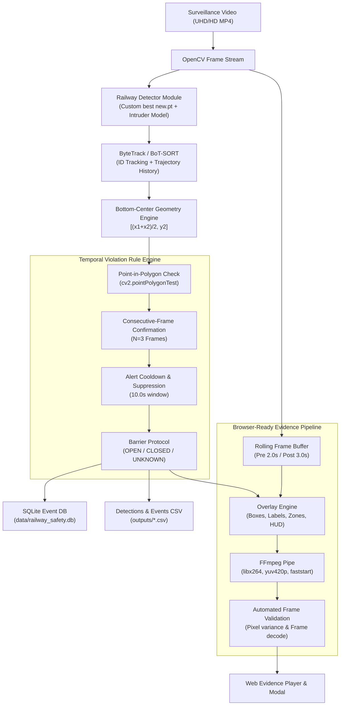

# Railway Level-Crossing Violation & Track Intrusion Detection System (Rail-Sentinel ROC)

[](https://fastapi.tiangolo.com)
[](https://github.com/ultralytics/ultralytics)
[](https://opencv.org/)
[](LICENSE)

> [!CAUTION]
> **Experimental Prototype Notice**: This system is a research and operational demonstration MVP developed for computer-vision assisted railway surveillance. It is **not** safety-certified or validated for deployment in mission-critical or life-safety railway signaling and interlocking systems.

---

## 1. Project Overview

**T225 Rail-Sentinel** is an end-to-end, locally runnable computer vision surveillance platform engineered for railway safety management. It monitors railway corridors and level crossings to detect unauthorized pedestrian and vehicular track intrusions, monitor level-crossing boundary violations, and generate forensic evidence clips.

### Key Solved Challenges
1. **Model Checkpoint Integration**: Seamlessly integrates the custom trained Ultralytics checkpoint (`best new.pt`, trained on railway infrastructure) alongside standard intruder detectors in a modular **Hybrid Detection Architecture**.
2. **Elimination of "Gray Video" & Encoding Errors**: Solves prior prototype failures where evidence clips decoded as blank or gray screens in modern web browsers by employing direct **H.264 `yuv420p` encoding via FFmpeg pipes** with post-generation decoding validation.
3. **Temporal Debouncing & Deduplication**: Eliminates alert spam and single-frame tracker flickering through consecutive-frame temporal confirmation and tracking-aware cooldown windows.
4. **Transparent Barrier State Protocol**: Distinguishes between verified automated signals and manual/demo inputs. When barrier status is `UNKNOWN`, crossing zone occupancy is safely flagged as a potential alert rather than falsely declaring a confirmed closed-barrier violation.

---

## 2. System Architecture



---

## 3. Inspected Custom Checkpoint Details (`best new.pt`)

During initial inspection of existing project assets, the downloaded checkpoint `best new.pt` was rigorously verified:

- **File Path**: `C:\Users\91636\Downloads\best new.pt`
- **File Size**: `5.22 MB` (5,468,634 bytes)
- **Base Architecture**: `YOLO11n` (Ultralytics detect model)
- **Parameter Count**: `2,605,369 parameters`
- **Trained Model Classes**:
  ```python
  {0: 'crossing', 1: 'track-signal-front', 2: 'track-sign-front'}
  ```
- **Training Origin**: Trained in Google Colab (`/content/T225/railway_detector`, 20 epochs, AdamW optimizer, `mAP50 = 0.316`).
- **Detection Modes Supported in T225**:
  - `hybrid` *(Recommended)*: Runs the custom checkpoint for railway crossing infrastructure, signals, and signs, while concurrently running intruder tracking for pedestrians and vehicles entering the danger polygons.
  - `custom`: Dedicated inference strictly using `best new.pt`.
  - `coco`: Focuses inference on pedestrian, bicycle, and vehicle tracking.

---

## 4. Repository Structure

```
T225-Railway-Safety/
├── backend/
│   ├── __init__.py
│   ├── config.py         # Path resolution, class mappings, threshold settings
│   ├── schemas.py        # Pydantic data schemas (Zones, Events, Detections)
│   ├── detector.py       # Dual YOLO inference (custom + intruder models)
│   ├── tracker.py        # Object tracking state, trails, and ID debouncing
│   ├── zones.py          # Polygon danger-zone geometry and coordinate scaling
│   ├── rules.py          # Violation rule engine & barrier state logic
│   ├── evidence.py       # Browser-compatible H.264 clip generator & validator
│   ├── storage.py        # SQLite database operations and CSV export
│   ├── processor.py      # Non-blocking background video processing worker
│   └── main.py           # FastAPI application entry point and REST routes
├── frontend/
│   ├── index.html        # Surveillance ROC interface, tabs, and modals
│   ├── style.css         # Responsive obsidian surveillance stylesheet
│   └── app.js            # Live telemetry polling, zone canvas editor, video controls
├── models/
│   └── README.md         # Instructions for checkpoint placement and weights
├── data/
│   ├── README.md         # Data directory documentation
│   ├── zones.json        # Saved polygon configurations
│   └── sample_railway.mp4# Sample video for immediate testing
├── outputs/
│   ├── .gitkeep
│   ├── detections.csv    # Exported frame-by-frame detections
│   └── events.csv        # Exported rule violations and alerts
├── evidence/
│   └── .gitkeep          # Generated H.264 verified evidence video clips
├── logs/
│   └── .gitkeep
├── tests/
│   ├── test_zones.py     # Unit tests for polygon geometry and persistence
│   ├── test_rules.py     # Unit tests for temporal confirmation & barrier logic
│   ├── test_evidence.py  # Unit tests for video encoding & frame validation
│   └── test_api.py       # Integration tests for FastAPI endpoints
├── .env.example          # Environment variable template
├── .gitignore            # Git exclusion rules (weights, large videos, DBs)
├── requirements.txt      # Python dependencies
└── README.md             # Complete technical guide and documentation
```

---

## 5. Prerequisites & Installation (Windows)

### Prerequisites
- **Operating System**: Windows 10 or 11 (64-bit)
- **Python**: Python 3.10 to 3.13 (Verified on Python 3.13.15)
- **Git**: Git for Windows installed

### Setup Instructions

1. **Clone or Navigate to the Project**:
   ```powershell
   cd C:\Users\91636\.gemini\antigravity\scratch\T225-Railway-Safety
   ```

2. **Create and Activate a Virtual Environment** *(Optional but Recommended)*:
   ```powershell
   python -m venv venv
   .\venv\Scripts\Activate.ps1
   ```

3. **Install Dependencies**:
   ```powershell
   pip install -r requirements.txt
   ```

4. **Configure Environment Variables**:
   Copy `.env.example` to `.env` or set the model path:
   ```powershell
   Copy-Item .env.example .env
   ```
   By default, `backend/config.py` automatically checks for `best new.pt` in `C:\Users\91636\Downloads\best new.pt` and `models/best.pt`.

---

## 6. Running the Application

### 1. Launch the Backend Server
```powershell
python -m uvicorn backend.main:app --host 127.0.0.1 --port 8000
```

### 2. Access the Surveillance Console
Open your web browser and navigate to:
```
http://127.0.0.1:8000
```

---

## 7. Operational Workflow

### Step 1: Select or Upload Video
- Select the pre-detected video `18828999-uhd_4096_2160_60fps.mp4` from the **Video Source** dropdown, or click **Upload Custom Video**.

### Step 2: Configure Danger Zones (Zone Studio Tab)
- Switch to the **Zone Configuration Studio** tab.
- Click **Capture Video Frame** to load a visual snapshot of the railway crossing.
- Click on the canvas to place polygon boundary points (at least 3 vertices).
- Select zone type: `Track Intrusion Zone` (High risk rails) or `Level-Crossing Conflict Zone`.
- Mark as demo or verified, and click **Save Zone Configuration**.

### Step 3: Set Barrier State
- In the top header bar, select the active barrier state:
  - `OPEN`: Level crossing open for street traffic.
  - `CLOSED`: Level crossing barrier arms lowered; crossing entry triggers a critical violation.
  - `UNKNOWN`: Barrier sensor unverified; crossing occupancies are logged as potential alerts with explicit cautionary notices.

### Step 4: Run Surveillance Inference
- Choose the **Inference Mode** (`Hybrid`, `Custom Checkpoint`, or `Intruder Detector`).
- Adjust the **Confidence Threshold** slider (default: `0.10`).
- Click **Start Analysis**.
- Watch real-time metrics update: active alerts, frame progress, detection counts, and speed (fps).

### Step 5: Review Alerts and Validated Evidence
- Switch to the **Alerts & Violation Log** tab to view filtered events.
- Switch to the **Evidence Vault** to inspect generated H.264 video clips with bounding box overlays, danger zones, tracking paths, and forensic metadata banners.
- Click **Download Detections CSV** or **Download Events CSV** for external reporting.

---

## 8. REST API Documentation

| Endpoint | Method | Description |
|---|---|---|
| `/api/health` | `GET` | System health check and worker state |
| `/api/model-info` | `GET` | Checkpoint metadata, classes, parameter count, and device |
| `/api/videos` | `GET` | List available surveillance clips from Downloads & uploads |
| `/api/videos/upload` | `POST` | Upload a new surveillance video (`multipart/form-data`) |
| `/api/video-frame` | `GET` | Extract a preview JPEG snapshot for zone plotting |
| `/api/processing/start` | `POST` | Start non-blocking video inference worker |
| `/api/processing/stop` | `POST` | Stop active video processing task |
| `/api/processing/status`| `GET` | Live telemetry (current frame, FPS, alerts count) |
| `/api/zones` | `GET` | Retrieve configured polygon zones |
| `/api/zones` | `PUT` | Save updated polygon zones (`JSON`) |
| `/api/barrier-state` | `PUT` | Update barrier state (`OPEN`, `CLOSED`, `UNKNOWN`) |
| `/api/events` | `GET` | Filtered violation event records |
| `/api/events/{id}` | `GET` | Retrieve single event metadata |
| `/api/evidence` | `GET` | List all verified evidence video files |
| `/api/evidence/{file}`| `GET` | Stream H.264 evidence video clip |
| `/api/outputs/csv` | `GET` | Download `detections.csv` |
| `/api/outputs/events-csv` | `GET` | Download `events.csv` |

---

## 9. Verification & Automated Test Suite

A complete test suite covering geometry, rule logic, video encoding, and REST endpoints is included in `tests/`:

```powershell
python -m pytest tests/ -v
```

### Test Coverage Summary:
- **`tests/test_zones.py`**:
  - Validates point-in-polygon math (`cv2.pointPolygonTest`).
  - Validates polygon scaling between normalized coordinates and video pixel resolutions.
  - Enforces minimum 3-point polygon rule.
  - Verifies JSON zone configuration persistence.
- **`tests/test_rules.py`**:
  - Tests 3-frame consecutive temporal confirmation.
  - Tests duplicate-alert suppression while objects remain within zones.
  - Validates `UNKNOWN`, `CLOSED`, and `OPEN` barrier logic.
- **`tests/test_evidence.py`**:
  - Tests synthetic frame annotation, H.264 encoding via FFmpeg, and frame variance validation (guaranteeing no gray/blank clips).
- **`tests/test_api.py`**:
  - Tests all REST API routes with Starlette TestClient.

---

## 10. Git Setup & Remote Repository Publishing

The repository is initialized locally with strict `.gitignore` protection to ensure heavy model weights (`*.pt`), raw 4K videos, and database files are never committed to Git.

### Publishing to a NEW GitHub Repository

Run the following commands in PowerShell to create and push to a new GitHub repository:

```powershell
# 1. Ensure you are in the repository directory
cd C:\Users\91636\.gemini\antigravity\scratch\T225-Railway-Safety

# 2. Add remote (replace YOUR_USERNAME with your GitHub username)
git remote add origin https://github.com/YOUR_USERNAME/T225-Railway-Safety.git

# 3. Rename default branch to main
git branch -M main

# 4. Push source code to GitHub
git push -u origin main
```

*(Note: When prompted by Git, sign in using your standard GitHub browser authentication or a Personal Access Token).*

---

## 11. Known Limitations & Future Roadmap

1. **Automatic Barrier Arm Perception**: The existing checkpoint `best new.pt` detects static infrastructure (`crossing`, `track-signal-front`, `track-sign-front`), but does not have a trained class for barrier boom angle. Future model iterations should include labeled classes for `barrier_arm_up` and `barrier_arm_down`.
2. **Thermal & Night-Vision Optimization**: Current weights are tuned for daylight conditions. Adding thermal dataset training will enhance low-light intrusion tracking.
3. **PTZ Camera Calibration**: Adding homography-based bird's-eye-view projection will enable physical metric distance calculations between intruders and oncoming rail vehicles.
